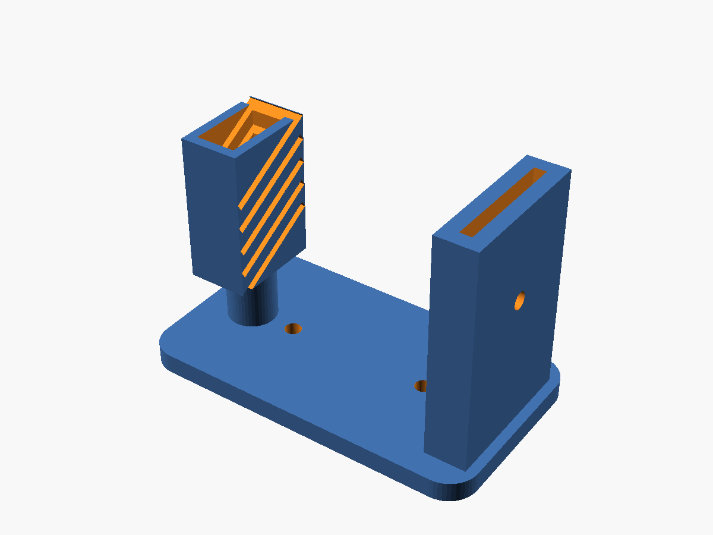

# 🚜 AgroConecta — Robô de Campo Inteligente

> **Global Solution 2026.2 · CitizenTech** · FIAP · Engenharia de Software, 4º ano
> Disciplina **Project-Based Maker Lab** — *Evolução de um robô inteligente para CitizenTech*
> Parte da plataforma **AgroConecta** · ODS 2 (Fome Zero e Agricultura Sustentável) e ODS 13 (Ação Climática)

## Equipe

| Integrante | RM |
|---|---|
| Eric de Carvalho Rodrigues | RM550249 |
| Renato Izumi Ichikawa | RM99242 |
| Bernardo Pinto Rocha | RM99209 |

## Links

| | |
|---|---|
| ▶️ **Vídeo demonstrativo** (até 6 min) | <https://youtu.be/akfVlb_59Rs> |
| 🧪 **Simulação no Wokwi** | <https://wokwi.com/projects/481088112604618753> |
| 🗂️ Plataforma AgroConecta | [Big Data](https://github.com/RodriguesEric134/agroconecta-bigdata) · [RPA](https://github.com/RodriguesEric134/agroconecta-rpa) |

---

## 1. O problema

O pequeno produtor perde parte da colheita por falta ou excesso de água, ondas de calor, geada e doenças
fúngicas favorecidas por umidade alta. Ele raramente tem estação meteorológica, sensores de solo ou um
agrônomo para interpretar os dados. Na prática, percorre a lavoura "no olho" e reage tarde.

## 2. A solução

Evoluímos o **carrinho autônomo** de Maker Lab, que andava e desviava de obstáculos, para um **robô de campo**
que patrulha os canteiros, **mede o ambiente**, **decide sozinho** o que fazer e **explica ao produtor** o
que está acontecendo.

| | Versão anterior (carrinho) | Esta versão (robô de campo) |
|---|---|---|
| Locomoção | 2 motores, anda e para | 2 motores de passo com manobra de desvio (ré + giro) |
| Sensores | Ultrassônico (obstáculos) | Ultrassônico + **DHT22** (temperatura e umidade do ar) + **umidade do solo** + **LDR** (luminosidade) |
| Atuadores | Motores | Motores + **servo da válvula de irrigação** + LED RGB + buzzer + display OLED |
| Inteligência | Regra fixa de distância | **TinyML embarcado** (classifica a lavoura) + **LLM na nuvem** (recomendação em linguagem natural) |
| Conectividade | — | Wi-Fi → **n8n** → **Supabase** + **Telegram** do produtor |

### Arquitetura

```
                        ┌──────────────────────── ESP32 (Wokwi) ─────────────────────────┐
  DHT22 · Solo · LDR ──►│ leitura + validação ──► TinyML (árvore de decisão, ~15 KB)       │
  HC-SR04 ─────────────►│      │                       │                                   │
                        │      ▼                       ▼                                   │
                        │ desvio de obstáculo   AÇÃO AUTÔNOMA: irrigar / parar / alertar   │──► motores, servo,
                        │                              │                                   │    LED, buzzer, OLED
                        │      tarefa de rede (FreeRTOS, não trava o robô)                 │
                        └──────────────┬───────────────▲───────────────────────────────────┘
                     telemetria (JSON) │               │ recomendação curta → OLED
                                       ▼               │
                        ┌──────────── n8n Cloud ──────────────────────────────────────────┐
                        │ webhook → situação mudou? → LLM (GPT-4o mini) → Supabase         │──► Telegram do
                        │                     └─ não → registra leitura                    │    produtor
                        └─────────────────────────────────────────────────────────────────┘
```

## 3. Componentes e pinagem (ESP32 DevKit C v4)

| Componente | Função | Pinos |
|---|---|---|
| DHT22 | Temperatura e umidade do ar | DATA → GPIO 15 · 3V3 · GND |
| Sensor de umidade do solo (potenciômetro deslizante no simulador) | Umidade do solo (%) | SIG → GPIO 35 (ADC) |
| Módulo LDR | Luminosidade (%) | AO → GPIO 34 (ADC) |
| HC-SR04 | Distância de obstáculos | TRIG → GPIO 5 · ECHO → GPIO 18 · 5V |
| Servo SG90 | Válvula de irrigação (0° fechada, 90° aberta) | PWM → GPIO 13 · 5V |
| 2× A4988 + 2× motor de passo NEMA 17 | Rodas esquerda e direita | Esq.: STEP 32 / DIR 33 · Dir.: STEP 16 / DIR 17 |
| LED RGB (cátodo comum) + 3 resistores 220 Ω | Estado do robô | R 25 · G 26 · B 27 |
| Buzzer | Alarmes sonoros | GPIO 14 |
| Display OLED SSD1306 128×64 (I²C 0x3C) | Leituras, classe da IA e recomendação | SDA 21 · SCL 22 |
| Botão azul "WI-FI ON/OFF" | Teste: simula queda de internet | GPIO 4 |
| Botão vermelho "FALHA SENSOR" | Teste: simula falha do DHT22 | GPIO 19 |

## 4. Inteligência Artificial

### 4.1 TinyML embarcado (decisão local, sem internet)
O ESP32 roda uma **árvore de decisão** treinada em Python e convertida para C++. A cada 2 s, ela recebe
`temperatura, umidade do ar, umidade do solo, luminosidade` e classifica a lavoura:

| Classe | Situação | Ação autônoma do robô | LED |
|---|---|---|---|
| `NORMAL` | Condições adequadas | Patrulha os canteiros (ou pausa no **modo noite**, luz < 15%) | 🟢 verde |
| `IRRIGAR` | Solo seco | **Para e abre a válvula** até o solo passar de 40% (histerese) | 🔵 azul |
| `ESTRESSE_TERMICO` | Calor extremo ou ar muito seco | Para e emite alerta sonoro | 🟠 laranja piscando |
| `RISCO_FUNGO` | Umidade alta e temperatura amena | Segue patrulha e sinaliza a área | 🟣 roxo |
| `RISCO_GEADA` | Temperatura ≤ 3 °C | Para e soa alarme | ⚪ branco |
| *(falha)* | Leitura do DHT22 inválida | Para, fecha a válvula e avisa | 🔴 vermelho piscando |

- **Treino** ([`tinyml/treinar_modelo.py`](tinyml/treinar_modelo.py)): 6.000 amostras geradas a partir de
  faixas agronômicas de referência, com ruído típico de sensores baratos (DHT22 ±0,5 °C, solo ±3%).
- **Resultado** ([`tinyml/metricas.txt`](tinyml/metricas.txt)): **93,5% de acurácia** no conjunto de teste,
  árvore com profundidade 7 e cerca de 15 KB de código-fonte.
- **Exportação**: `micromlgen` gera [`firmware/modelo_tinyml.h`](firmware/modelo_tinyml.h).
- **Verificação** ([`tinyml/verificar_exportacao.py`](tinyml/verificar_exportacao.py)): o código C++
  exportado foi comparado com o modelo Python em 6.000 amostras novas. **6.000/6.000 previsões idênticas.**

### 4.2 LLM na nuvem (recomendação contextualizada)
Quando a classe **muda**, o robô envia a telemetria ao n8n (workflow
[`n8n/workflow_robo_campo.sdk.ts`](n8n/workflow_robo_campo.sdk.ts)). Lá, um LLM (**GPT-4o mini**) recebe as
leituras, a classe do TinyML e a ação que o robô já tomou, e devolve:
- uma **recomendação curta** (até 60 caracteres), exibida no **OLED do robô**;
- uma **explicação completa**, enviada ao **produtor no Telegram** (bot @GsRPA_bot do AgroConecta).

Toda leitura é gravada na tabela `leituras_robo` do **Supabase** ([`n8n/schema_robo.sql`](n8n/schema_robo.sql)).
Sem mudança de situação, o robô manda apenas um "batimento" a cada 30 s, sem chamar a IA.

Exemplo real (teste de 18/11/2026, alerta de geada): o robô enviou `2,1 °C`, ar `88%`, solo `60%`, classe
`RISCO_GEADA`; a IA respondeu **"Proteja suas plantas da geada!"** em 4,5 s.

## 5. Testes e situações de falha

| Cenário | Como reproduzir no Wokwi | Comportamento esperado |
|---|---|---|
| Operação normal | DHT22 em 24 °C / 60%; solo no meio | LED verde, rodas girando, OLED "PATRULHA" |
| Solo seco | Arraste o slider do solo para baixo (< 25%) | Rodas param, servo vai a 90° (válvula aberta), LED azul; ao subir o solo acima de 40%, fecha e volta a patrulhar |
| Calor extremo | DHT22 em 38 °C / 25% | Para, LED laranja, bips; recomendação da IA no OLED e no Telegram |
| Geada | DHT22 em 2 °C | Para, LED branco, alarme |
| Risco de fungo | DHT22 em 22 °C / 95%, solo alto, pouca luz | LED roxo, segue patrulhando |
| Noite | LDR no mínimo | Pausa a patrulha (modo NOITE) |
| Obstáculo | HC-SR04 com distância < 25 cm | Bip, ré, giro e retomada da patrulha |
| **Falha do sensor** | Botão vermelho "FALHA SENSOR" | Para, fecha a válvula, LED vermelho piscando, envia `sensor_ok=false` |
| **Queda de internet** | Botão azul "WI-FI ON/OFF" | OLED mostra "OFFLN"; o robô **continua decidindo sozinho** com o TinyML |
| **IA indisponível** | (lado do n8n) | O n8n usa a recomendação local de cada classe e o produtor ainda recebe o alerta |

## 6. Como executar

### Simulação (Wokwi)
1. Abra o link do Wokwi acima **ou** crie um projeto ESP32 em <https://wokwi.com/projects/new/esp32>.
2. Copie para o projeto os arquivos da pasta [`firmware/`](firmware/): `sketch.ino`, `diagram.json`,
   `modelo_tinyml.h` (botão **+** → *New file*) e `libraries.txt`.
3. Clique em ▶️. O robô conecta ao Wi-Fi `Wokwi-GUEST` e começa a patrulhar.
4. Clique nos sensores (DHT22, slider do solo, LDR, HC-SR04) para mudar os valores e acompanhe o OLED, o LED e o Monitor Serial.

### Retreinar o modelo TinyML
```bash
cd tinyml
pip install scikit-learn numpy micromlgen
python treinar_modelo.py          # gera firmware/modelo_tinyml.h e metricas.txt
python verificar_exportacao.py    # confere C++ × Python
```

### Backend (n8n + Supabase)
- Webhook: `POST https://gsultimosemestreultimoano.app.n8n.cloud/webhook/robo-campo`
- Tabela: `leituras_robo` ([`n8n/schema_robo.sql`](n8n/schema_robo.sql))
- Exemplo de chamada:
```bash
curl -X POST https://gsultimosemestreultimoano.app.n8n.cloud/webhook/robo-campo \
  -H "Content-Type: application/json" \
  -d '{"robo_id":"robo-campo-01","temp_ar":36.2,"umid_ar":24,"umid_solo":45,"luz":95,"distancia_cm":150,"classe":"ESTRESSE_TERMICO","acao":"Parou e emitiu alerta de calor","modo":"PARADO_ALERTA","sensor_ok":true,"irrigando":false,"evento":true}'
# → {"ok":true,"id":"…","recomendacao":"…","fonte":"gpt-4o-mini"}
```

## 7. Peça modelada em 3D

[`modelo3d/suporte_sensores.scad`](modelo3d/suporte_sensores.scad) (OpenSCAD, paramétrico) · [`STL`](modelo3d/suporte_sensores.stl)

Suporte que vai no chassi do carrinho:
- **garra vertical** para o sensor capacitivo de solo, com parafuso de trava para ajustar a profundidade no canteiro;
- **abrigo ventilado** para o DHT22, com aletas inclinadas: o ar circula, mas o sol não bate direto no sensor, o que evita leituras de temperatura infladas;
- pilar que afasta o abrigo do calor dos motores e **furos M3** de fixação.



## 8. Estrutura do repositório

```
firmware/        sketch.ino · modelo_tinyml.h · diagram.json (circuito Wokwi) · libraries.txt
tinyml/          treinar_modelo.py · verificar_exportacao.py · metricas.txt
n8n/             workflow_robo_campo.sdk.ts (backend) · schema_robo.sql
modelo3d/        suporte_sensores.scad · .stl · .png
```

## 9. Limitações e próximos passos
- A entrega é **simulada** (Wokwi): o carrinho físico não foi montado nesta etapa. O circuito, o firmware e a peça 3D estão prontos para a montagem.
- O modelo foi treinado com dados sintéticos baseados em faixas agronômicas. O próximo passo é recalibrar com leituras reais de campo, que já ficam gravadas no Supabase.
- O webhook não tem autenticação, o que é aceitável para a demonstração acadêmica. Em produção, entraria um token por robô.
